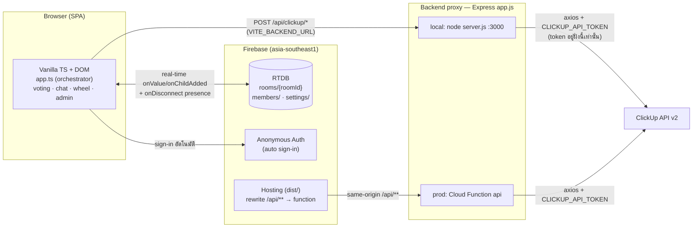
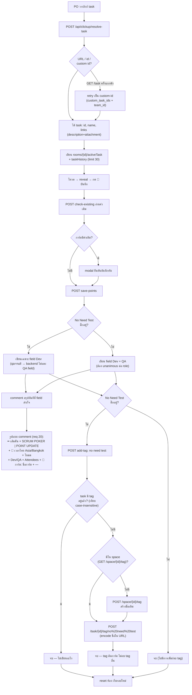
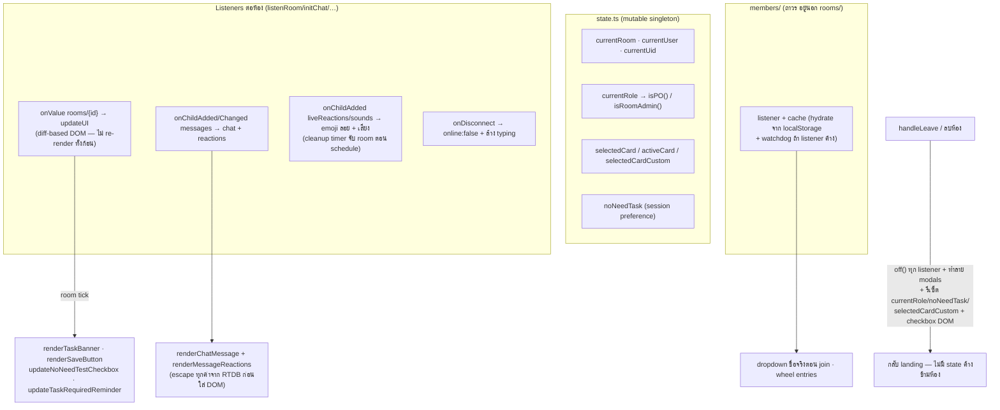
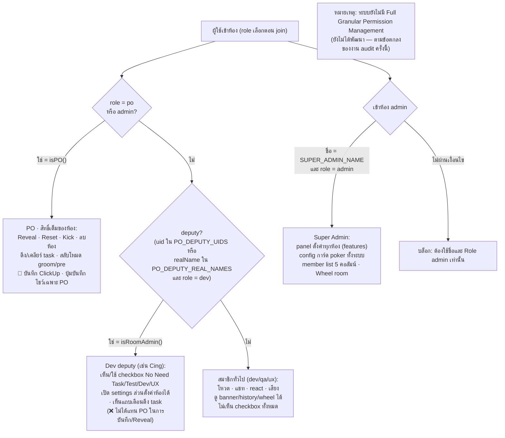

# Scrum Poker — Architecture (Mermaid)

เอกสารสถาปัตยกรรมของระบบ — อ้างอิงจาก implementation จริงใน repository ณ เวลาที่เขียน
(อัปเดตล่าสุด: พ.ย. 2026 หลัง Bug Audit & Cleanup) · บริบทโมดูล/คำสั่งเต็ม ดู `CLAUDE.md`
และคู่มือติดตั้ง ดู `SETUP.md`

---

## 1. System Architecture

Frontend เป็น SPA (Vanilla TypeScript + Vite ไม่มี framework) คุยกับ Firebase RTDB
แบบ real-time โดยตรง ส่วน ClickUp ทั้งหมดผ่าน backend proxy เพราะ token ห้ามออกจาก server



หมายเหตุ: มี `render.yaml` สำหรับ deploy backend บน Render อีกทาง (optional) —
โค้ด Express ชุดเดียวใช้ทั้ง local / Cloud Function / Render

---

## 2. Scrum Voting Flow

รอบโหวต 1 task — ตั้งแต่ดึงการ์ดจนบันทึกแล้ว reset เริ่มรอบใหม่ (ทุกสเต็ป real-time ทุก client)

```mermaid
sequenceDiagram
    participant PO as PO
    participant M as สมาชิก (Dev/QA/UX)
    participant RTDB as Firebase RTDB
    participant CU as ClickUp (ผ่าน backend)

    PO->>RTDB: วางลิงก์ → resolve-task → activeTask
    RTDB-->>M: banner ชื่อ task + ลิงก์ (real-time)
    Note over PO,M: ถ้ายังไม่มี task → แถบเตือน "ยังไม่ได้เลือกการ์ด"<br/>(ซ่อนได้ด้วย No Need Task)

    M->>RTDB: เลือกการ์ด / custom point → users/{uid}/vote
    Note over PO: คนสุดท้ายที่ยังไม่โหวต → มี animation เตือน (admin เห็น)

    PO->>RTDB: 👁 Reveal (มี modal เตือนถ้ามีคนยังไม่โหวต)
    RTDB-->>PO,M: revealed + locked + revealTime + speakers (min/max ต่อ role)
    Note over RTDB: auto-unlock countdown (ค่า default 30 วิ ปรับได้ใน settings)

    alt ติ๊ก No Need Test (admin ของห้อง)
        PO->>CU: บันทึกเฉพาะ Dev field + comment "QA: no need test"<br/>+ tag "no need test" (ไม่แตะ QA field)
    else ติ๊ก No Need Dev (admin ของห้อง)
        PO->>CU: บันทึกเฉพาะ QA field + comment "Dev: no need dev"<br/>(ไม่แตะ Dev field · ไม่ติด tag — ต่างจาก No Need Test)
    else ปกติ
        PO->>CU: บันทึก Dev + QA field (unanimous ต่อ role)<br/>+ comment สรุป (groom) / ช่วง min-max (pre-groom)
    end
    CU-->>PO: ผล per-field (ok/error) → splash กลางจอ

    PO->>RTDB: reset รอบอัตโนมัติ (ล้าง vote ทุกคน + task + unlock)
    RTDB-->>PO,M: หน้าจอกลับสถานะรอบใหม่ (real-time)
```

---

## 3. ClickUp Integration Flow

ทุกการเขียนลงการ์ดผ่าน backend (`backend/app.js`) — รวมถึง flow การติด tag
`no need test` ที่ใช้ tag เดิมใน space ไม่สร้างซ้ำและไม่ลบ tag อื่น



Error handling: field พัง = toast ❌ ไม่ reset ห้อง (ลองใหม่ได้) · comment พัง = ⚠️ แต่ถือว่ารอบจบ ·
tag พัง = ⚠️ toast แจ้ง (point ขึ้นการ์ดแล้ว)

---

## 4. State Management Flow (Real-time)

ไม่มี state library — ใช้ object กลาง `state.ts` + Firebase listeners ที่ detach ครบทุกตอน leave



---

## 5. Existing Permission Flow (ระบบสิทธิ์ปัจจุบัน)

สิทธิ์ที่มีอยู่จริงในโค้ด — 3 ชั้น (ไม่มี permission matrix แบบ granular)



---

## การตรวจสอบ (Validation)

- Syntax Mermaid ตรวจด้วยการทบทวนโครงสร้าง manually (repo ไม่มี mermaid CLI)
- ทุกแผนภาพเขียนจากโค้ดจริง: `app.ts` `voting.ts` `clickup.ts` `room.ts` `chat.ts`
  `reactions.ts` `sounds.ts` `wheel.ts` `admin.ts` `members.ts` `state.ts` `backend/app.js`
- หากแก้ flow ใดในอนาคต ให้อัปเดตแผนภาพที่เกี่ยวข้องในไฟล์นี้ด้วย
